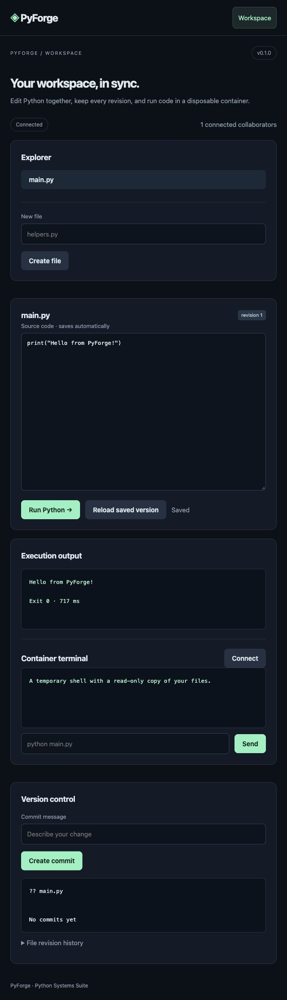

# PyForge

A shared Python workspace with revision control and container execution.

A runnable **v0.1 learning project** with real core behavior, a browser interface, and regression tests. The scope and limits below are intentional; this repository does not claim production readiness.

## Preview

## Quick start

Python 3.11 or newer is required. Git is required for the IDE and Git hosting projects. Commands below use a POSIX shell; on Windows activate the environment with .venv\Scripts\activate.

~~~sh
git clone https://github.com/surender799/pyforge-cloud-ide.git
cd pyforge-cloud-ide
python3 -m venv .venv
source .venv/bin/activate
python -m pip install -e '.[dev]'
python -m pyforge
~~~

Open http://127.0.0.1:8100 in two tabs. Edit main.py and watch the second tab update. Run the program, create a Git commit, and open the container terminal.

## What works

- Shared WebSocket editing with presence and optimistic revision checks.
- Persistent SQLite file history, explicit conflict recovery, and reconnect handling.
- Real local Git commits and status, with a separate materialized working tree.
- Docker execution and an interactive shell: no network, no capabilities, a non-root user, CPU/memory/process limits, bounded output, and a disposable filesystem.
- Workspace snapshots stream over stdin, so remote Docker engines work without host bind mounts.

## Architecture

~~~text
Browser -- WebSocket --> FastAPI
FastAPI --> SQLite revisions
FastAPI --> Git working tree
FastAPI -- snapshot stream --> Docker sandbox
~~~

## Containers

Run once before using Run or Terminal:

    docker pull python:3.13-alpine

Files are snapshotted at execution/terminal startup. Changes made inside a container are temporary and do not modify the editor. Runs have a 15-second limit; terminal sessions last at most five minutes. Docker is a containment layer for local development, not a hardened boundary for hostile public tenants.

## Persistence

By default, files and Git state live under .data/pyforge. Change this with --data. The SQLite database is the source of truth; editing the materialized workspace directly is not supported.

## API

- GET /api/files; GET /api/file?path=main.py
- POST /api/files with path, content, revision
- GET /api/history?path=main.py
- POST /api/commit with message
- POST /api/run with path
- WS /ws and WS /terminal

## Tests

~~~sh
python -m pytest -q
~~~

Container integration is opt-in:

~~~sh
docker pull python:3.13-alpine
RUN_DOCKER_TESTS=1 python -m pytest -q
~~~

GitHub Actions runs the complete suite, including Docker integration, on Python 3.11 and 3.13. Tests cover behavior and failure conditions, including the project-specific persistence and network paths where applicable. Browser assets are included in the Python package.

## Scope and limits

Editing uses whole-file optimistic concurrency, not CRDT merging; conflicting edits require manual reconciliation. One shared workspace per process. This is a local, single-user development server with multiple browser sessions, not a hosted multi-tenant IDE. The terminal is a line-oriented shell, not a PTY. Containers require a running Docker engine and the Python image; there is no unsafe host-execution fallback.

All provided web commands listen on 127.0.0.1. Local state is stored in ignored .data directories. Do not commit runtime data or credentials. See [SECURITY.md](SECURITY.md).

## Project layout

- pyforge/: core implementation, HTTP application, CLI, and static UI
- tests/: regression and integration tests
- .github/workflows/tests.yml: Python test matrix

## License

MIT. See [LICENSE](LICENSE).
